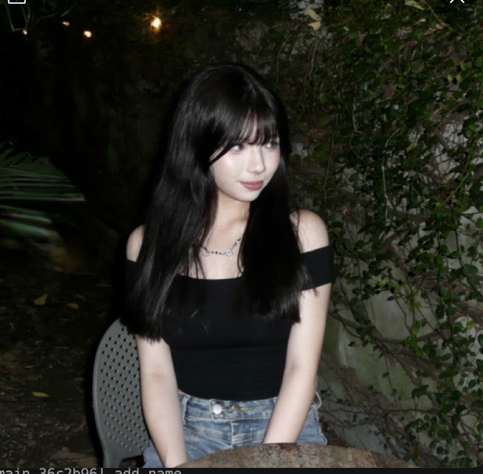
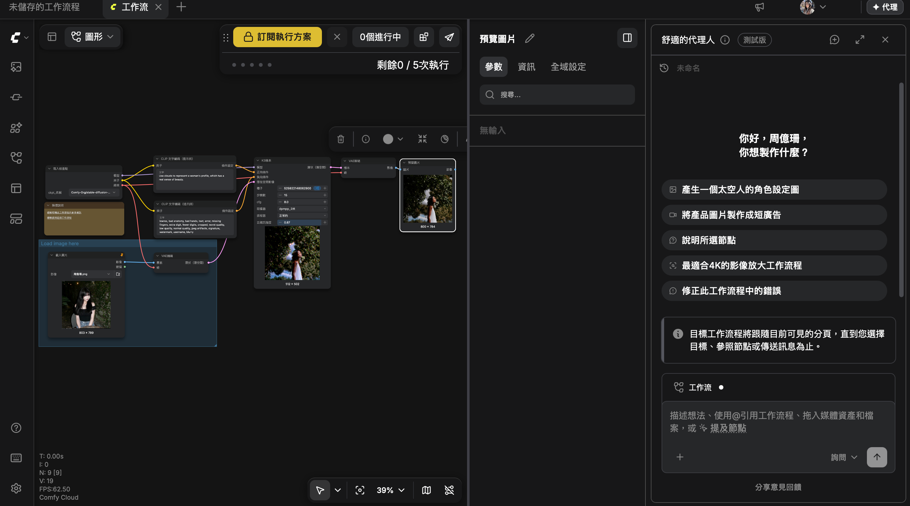

<h1>原圖<h1>

<h1>生成出來的圖<h1>

<h1>工作流程圖圖<h1>

<h2>正提示詞:
<h3>Use clouds to represent a woman's profile, which has a real sense of beauty.<h3>
<h3>反提示詞：
<h3>owres, bad anatomy, bad hands, text, error, missing fingers, extra digit, fewer digits, cropped, worst quality, low quality, normal quality, jpeg artifacts, signature, watermark, username, blurry.<h3>
<h2>心得：
<h3>經過這次使用此程式乘乘圖片的經驗，讓我從一開始的不知道如何下提示詞，導致圖片城城不出我想要的效果，到我慢慢掌握該如和下提示詞，最終成估生成出我想要的圖片，這個過程讓我學會了如何表達想法以及訓練耐心。